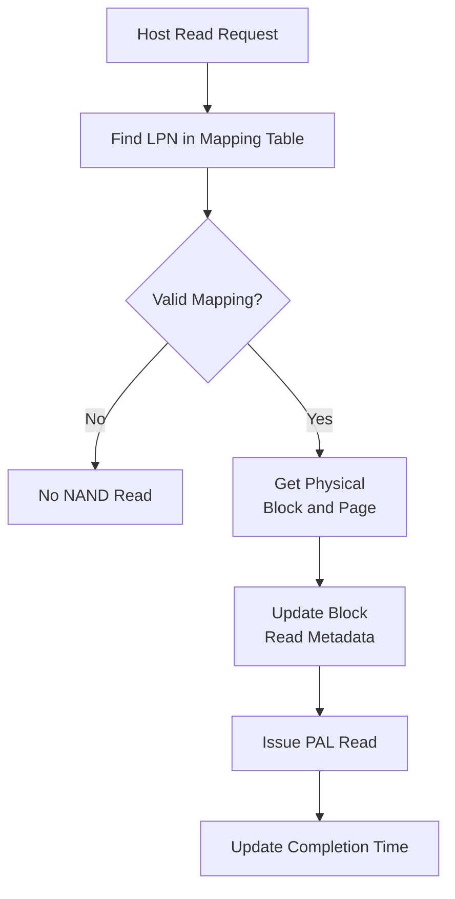
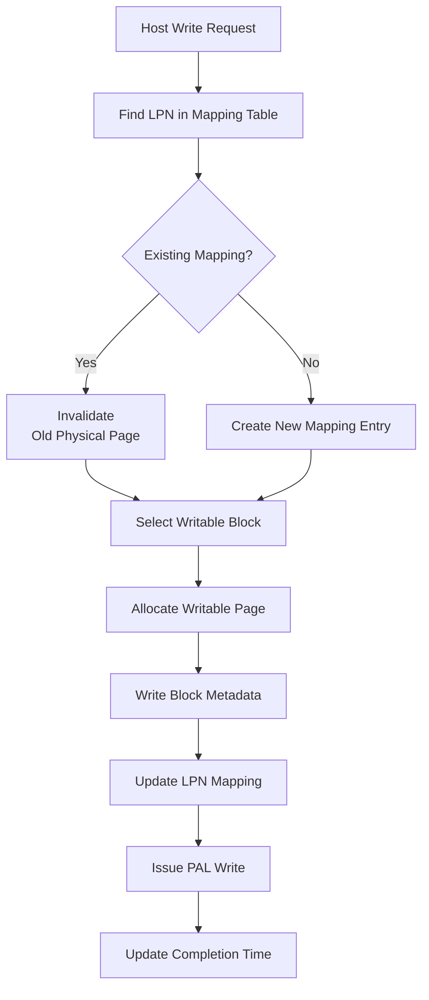

# Lab 1 — FTL Read / Write

:::info
[課程 DC 群組連結](https://discord.gg/297BbGzVT)
:::

## 環境
:::warning
使用 Ubuntu 24.04，並使用以下指令安裝套件
```
sudo apt update
sudo apt install python3 cmake build-essential
```
:::

## 概述

這次 Lab 需要完成 page-mapping FTL 的基本 **read** 與 **write** 操作。

同學只需要修改：

```cpp
lab1_read_write_student.cc 
```

並完成以下部分的程式碼即可：

```cpp
// TODO: Read Implementation 
 
// TODO: Write Implementation - Write Path 
// 完成至流程圖中的 Allocate Writable Page
 
// TODO: Write Implementation - Physical Write 
// 完成剩下的部份
```

---

## 說明

> PAL 為 Parallelism Abstraction Layer，負責計算  NAND flash 硬體執行的延遲。

### 1. Read Implementation

從接收到一個 read request 到完成模擬的流程如下所示。

```cpp
// TODO: Read Implementation 
```



### 2. Write Implementation

從接收到一個 write request 到完成模擬的流程如下所示。
```cpp 
// TODO: Write Implementation - Write Path
// 完成至 Allocate Writable Page
 
// TODO: Write Implementation - Physical Write 
// 完成剩下的部份
```



### 3. 評分方式
修改完程式碼之後，同學可以運行
```
python3 compare_lab1.py
```
腳本會將同學的 FTL 以及正確的 FTL 各模擬一次，紀錄 mapping table、physical block 的狀態、送出至 PAL 的 request 等資訊，最後進行比對。

如果看到以下結果
```
FTL snapshot: MATCH
PAL trace: MATCH
```
代表程式的部分已經通過，可以開始錄製影片了。

---
## 一些提示
### FTL Mapping

FTL 會維護一個 mapping table

```cpp
ftl.table 
```

概念上，table 儲存的是：

```text
LPN → Physical Location 
```

其中 Physical Location 包含以下兩個資訊

```text
Block Index 
Page Index 
```

可以使用以下方式取得某個 LPN 的 mapping entry

```cpp
ftl.table.find(req.lpn) 
```

如果回傳的 iterator 等於

```cpp
ftl.table.end() 
```

代表該 LPN 目前沒有 mapping。

也可以透過這個方式新增一筆 mapping entry

```cpp
ftl.table.emplace(...) 
```

每一筆 mapping entry 都會記錄該 LPN 所對應的 physical block 與 page。


---

### Block Lookup

Physical blocks 的資訊儲存在

```cpp
ftl.blocks 
```

可以使用以下方式查找 block

```cpp
ftl.blocks.find(blockIndex) 
```

---

### Free Block Allocation

若要取得一個可以寫入新資料的 block

```cpp
ftl.getLastFreeBlock(req.ioFlag) 
```

這個 function 會回傳一個 writable block 的 index。

---

### Free Page Allocation

選定 block 後，可以使用以下方式取得這個 block 內下一個可寫入的 page

```cpp
block.getNextWritePageIndex(...) 
```

---

### Block Metadata

讀取 physical page 時

```cpp
block.read(...) 
```

寫入 physical page 時

```cpp
block.write(...) 
```

當舊資料失效時

```cpp
block.invalidate(...) 
```

這些操作可以維護 physical block 內部的 metadata。

---

### PAL Access

需要將 NAND operation 送到 PAL 進行 NAND 層面的模擬。

Read：

```cpp
ftl.pPAL->read(...) 
```

Write：

```cpp
ftl.pPAL->write(...) 
```

發送 PAL operation 前，這兩個變數務必包含正確的 physical location：

```cpp
palRequest.blockIndex 
palRequest.pageIndex 
```


---

### Timing

程式已經有提供 DRAM 和 CPU 的 latency model

```cpp
ftl.pDRAM->read(...) 
ftl.pDRAM->write(...) 
 
tick = finishedAt; 
tick += applyLatency(...); 
```

請勿自行修改。

但 PAL 和 block operation 的延遲依舊需要同學使用 `beginAt` 和 `finishedAt` 進行計算，此部份也會影響最終結果是否正確。

---

### Garbage Collection

GC 已經實作完成

```cpp
if (ftl.freeBlockRatio() < gcThreshold) { 
  ftl.handleOnDemandGC(tick); 
} 
```

請勿修改此部分。


