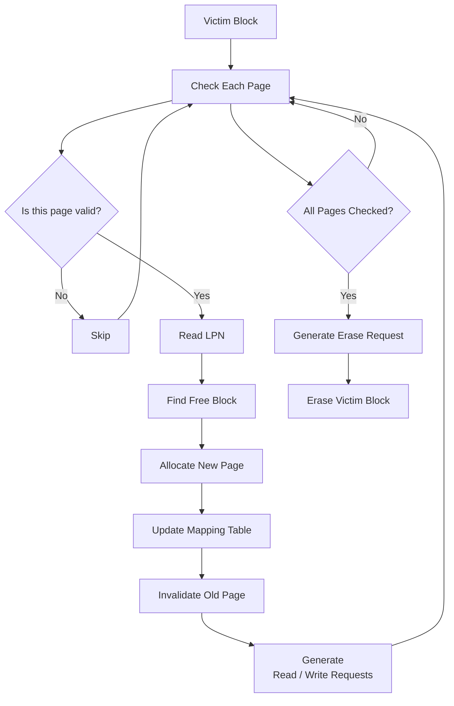

# Lab 2 — Garbage Collection

:::info
[課程 DC 群組連結](https://discord.gg/297BbGzVT)
:::

## 環境
:::warning
使用 Ubuntu 24.04，並使用以下指令安裝套件
```
sudo apt update
sudo apt install python3 cmake build-essential
```
:::

## 概述

這次 Lab 需要完成 page-mapping FTL 的 **Garbage Collection (GC)** 操作。

同學只需要修改：

```cpp
lab2_gc_student.cc 
```

並完成以下部分的程式碼即可：

```cpp
// TODO: Find victim block in ftl.blocks
// TODO: GC Implementation 
// TODO: Create an erase request and add it to eraseRequests
```

---

## 說明

### 1. GC Implementation

從接收到 vitim blocks 到完成 GC 的流程如下所示。



### 2. 評分方式
修改完程式碼之後，同學可以運行
```
python3 compare_lab2.py
```
腳本會將同學的 FTL 以及正確的 FTL 各模擬一次，紀錄 mapping table、physical block 的狀態、送出至 PAL 的 request 等資訊，最後進行比對。

如果看到以下結果
```
FTL snapshot: MATCH
```
代表程式的部分已經通過，可以開始錄製影片了。

---
## 一些提示

### IO Flag & idx 
模擬器原本支援一個 page 內包含多個 I/O unit（可以理解成 subpage），因此 `ioFlag` 是用來標記這次 request 要操作哪些 I/O unit。

不過在 Lab 裡，`ioUnitInPage` 已經被設定為 1，不使用 subpage 相關操作，所以一個 page 只有唯一的 I/O unit，也就是 `idx = 0`。

---

### Block Lookup

Physical blocks 的資訊儲存在

```cpp
ftl.blocks 
```

可以使用以下方式查找 block

```cpp
ftl.blocks.find(blockIndex) 
```
---

### Check Page Validity


```cpp
std::vector<uint64_t> lpns;
Bitset bit(1);
block->second.getPageInfo(pageIndex, lpns, bit)
```

這個函式會回傳 `bool` 值，`true` 代表該 page 中存在有效資料。
`lpns` 和 `bit` 原本會拿來處理前面所說的 subpage 操作，但因為 lab 裡不考慮，因此這邊 bit 的值不重要，並且 `lpns` 也只需要 `lpns[0]`，來表示位於 `pageIndex` 這個位置 page 的 lpn。

---
### Finding a Free Block

```cpp
ftl.getLastFreeBlock(ioFlag) 
```
這個 function 會回傳一個 writable block 的 index。
`ioflag` 如前面所述，只需要傳入長度為 `1`，且設為 `1` 的 bitset。

---

### Free Page Allocation

選定 block 後，可以使用以下方式取得這個 block 內下一個可寫入的 page。
```cpp
block.getNextWritePageIndex(idx) 
```
`idx` 如前面所述，只需要傳入 `0`，因為只有 `idx 0` 有效。

---
### Block Metadata

讀取 physical page 時

```cpp
block.read(pageIndex, idx, beginAt) 
```

寫入 physical page 時

```cpp
block.write(newPageIdx, lpn, idx, beginAt); 
```

當舊資料失效時

```cpp
block.invalidate(pageIndex, idx);
```

這些操作可以維護 physical block 內部的 metadata。

---

